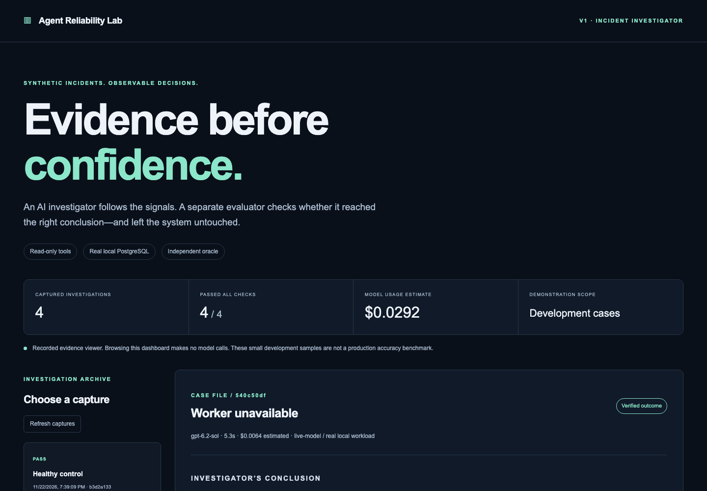
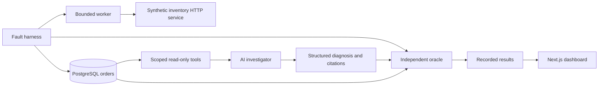

# Agent Reliability Lab

[](https://github.com/kilicerdal/agent-reliability-lab/actions/workflows/verify.yml)


[](LICENSE)

**An AI incident investigator with an independent verdict.** Inject a synthetic failure, let the investigator inspect read-only tools, then check its diagnosis against the known cause and actual workload state.

Built by **Erdal Kilic** with AI assistance for implementation, tests and documentation. Personal engineering work; no employer systems, customer records or production incidents.



[Full desktop capture](docs/assets/dashboard-1440.png) · [Mobile capture](docs/assets/dashboard-390.png)

## Reviewer journey — five minutes

1. Start the recorded viewer below. No API key is needed to inspect the included captures.
2. Choose **Worker unavailable**: compare the investigator’s explanation with its cited configuration and workload signals.
3. Open the independent verdict and execution trace. The agent does not receive the expected answer or choose its own grade.
4. Inspect [the rejection tests](backend/tests/test_evaluation.py): a plausible answer with invented evidence, a wrong cause, or changed workload state fails.
5. Read [scope and limitations](docs/evaluation.md) before interpreting a passing result.

## V1 scope

| Scenario | Actual local fault | Observable effect |
|---|---|---|
| Database slowdown | PostgreSQL executes a controlled `pg_sleep` in the query path | Measured lookup latency exceeds 100 ms |
| Worker unavailable | Synthetic worker is disabled by configuration | Accepted order remains queued |
| Dependency failure | Inventory region changes to an unsupported value | Real local HTTP request returns 503; order remains queued |
| Healthy control | No fault enabled | Query stays below threshold and order completes |

These are deliberately small **development scenarios**, not held-out cases or production-scale fault reproductions. The SQL delay models latency; it does not demonstrate finding an inefficient query plan. A bounded background worker invocation reproduces the queue behavior; this is not a Kubernetes process-failure test.

## View the captured results

Requires Docker Engine with the Compose v2 plugin. The dashboard is local at **http://localhost:3310**.

```bash
docker compose up --build -d
```

The included four captures were produced by live `gpt-6.2-sol` calls against the actual local PostgreSQL/HTTP workload. The viewer serves those records; browsing it cannot invoke a model. No public paid execution endpoint exists.

Stop with `docker compose down`. This preserves the database volume and the local cost ledger. Do not delete `.private/budget.sqlite` to reset spending history.

### Native development

Tested with Python 3.13, Node 24 and PostgreSQL 17. Dependencies are pinned in `requirements.lock` and `dashboard/package-lock.json`.

```bash
python3.13 -m venv .venv
.venv/bin/pip install -r requirements.lock
npm --prefix dashboard ci
```

Use an isolated PostgreSQL database. `LAB_DATABASE_URL` is its owner connection; `LAB_READER_DSN` uses the separate `lab_reader` role. The initialization command creates that role and grants it SELECT on orders and observations, without access to injected fault configuration. See `.env.example` for **demo-only** local credentials; never use them in production.

Start the inventory service and results API in separate terminals from the repository root:

```bash
PYTHONPATH=backend .venv/bin/python -m uvicorn lab.inventory:app --host 127.0.0.1 --port 8811
PYTHONPATH=backend .venv/bin/python -m uvicorn lab.api:app --host 127.0.0.1 --port 8810
```

Then start the dashboard:

```bash
npm --prefix dashboard run build
npm --prefix dashboard run start
```

The optional macOS helper `scripts/local-postgres.sh` creates a fresh local cluster under `.private/`. It requires Homebrew PostgreSQL 17 and an unused port 5544. Local trust authentication is suitable only for this isolated loopback demonstration.

## Run a new investigation — paid, explicit action

Only synthetic alert text, tool schemas and synthetic tool observations are sent to OpenAI. Use an existing key through the environment or a local ignored env file. Never put it in source code, screenshots or browser JavaScript.

For Docker, set `OPENAI_API_KEY` in your shell first, then:

```bash
mkdir -p .private evidence/runs
docker compose run --rm -e OPENAI_API_KEY runner python -m lab.run database-slowdown
```

For native execution, set the two database DSNs and `OPENAI_API_KEY` in the shell, then:

```bash
PYTHONPATH=backend .venv/bin/python -m lab.run database-slowdown
# Explicitly run all four development cases:
scripts/evaluate.sh
```

The CLI also accepts `--env-file /path/to/an/existing/ignored/env-file`; the key stays server-side and is not copied into the project. Neither CI nor the browser tests make paid model calls.

The runner uses the Responses API, strict structured output, an eight-request investigation limit, bounded context, 4,096 maximum output tokens per request, disabled SDK retries and an atomic SQLite reservation ledger. See [cost controls](docs/cost-controls.md) for assumptions and limits. The runner does not change account billing, enable auto-recharge, or schedule recurring calls.

## Architecture



Fault configuration lives outside the tool-visible tables. Tools use a database role that cannot mutate the workload or SELECT the injected configuration. They accept no caller-supplied experiment ID or arbitrary SQL. The oracle and investigator run within the same trusted Python application, **not separate security sandboxes**. V3 will address stronger boundaries and adversarial cases.

## Verification

Offline contracts, evaluator and budget checks (database tests skip without the integration environment):

```bash
.venv/bin/pytest -q
```

Complete integration tests require the local PostgreSQL and inventory service, with both DSNs set:

```bash
.venv/bin/pytest -q
```

With the read-only API and built dashboard running:

```bash
cd dashboard
npx playwright install chromium
npm run test:browser
```

The browser suite checks desktop and mobile Chromium, keyboard access, WCAG A/AA axe checks, evidence navigation, no POST requests and explicit service errors. Mobile coverage is emulation, not a physical-device test. CI also builds and exercises the Compose topology.

## Evidence and next releases

- [Live development captures](evidence/runs): diagnoses, tool outputs, token counts, conservative cost estimates, source digests and before/after workload hashes.
- [Evaluation method and honest limits](docs/evaluation.md)
- [Four-release roadmap](docs/roadmap.md)
- [V1 verification record](docs/v1-verification.md)

V1 has no autonomous remediation, no public live agent, no multi-agent benchmark, no MCP security certification and no production-readiness claim. Each later capability needs its own measured evidence.
